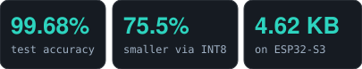
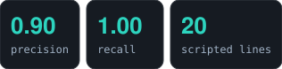
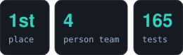
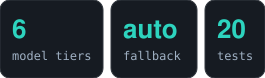
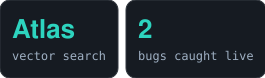
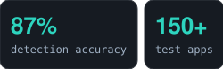
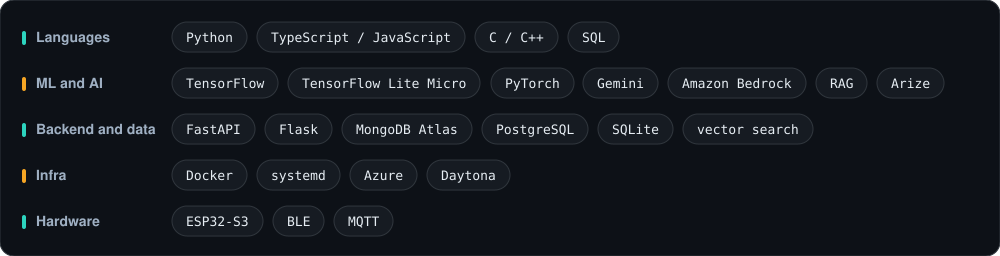
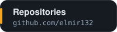

<h3 align="center">👋 Hi, I'm Elmir</h3>

  AI and backend engineer, M.Eng. CS candidate at <b>Cornell Tech</b>, building toward founding an AI startup. 
  Background in cybersecurity (B.Sc. honors, M.Sc. in progress), now focused on applied ML systems that ship.

  📍 New York, NY &nbsp;·&nbsp; 🎓 Cornell Tech, M.Eng. CS (May 2027) &nbsp;·&nbsp; 🌐 <a href="https://elmirabd.me">elmirabd.me</a>

## 🚀 Shipped work

<table>
  <tr>
    <td width="50%" valign="top">
      <h3>📡 <a href="https://github.com/elmir132/ble_vulnerability_tinyml">TinyML BLE vulnerability detection</a></h3>
      
Neural classifier for real-time Bluetooth Low Energy threat detection on embedded hardware. Published at <i>CH&amp;CMiGIN-2026</i>, Kraków (<a href="https://ceur-ws.org/Vol-4278/short03.pdf">CEUR-WS Vol-4278</a>, Scopus-indexed).

      

      
<code>TensorFlow Lite Micro</code> <code>ESP32-S3</code> <code>BLE</code> <code>0.9&nbsp;ms</code>

    </td>
    <td width="50%" valign="top">
      <h3>🗣️ <a href="https://github.com/elmir132/advocate">Advocate, live interpreter for renters</a></h3>
      
A renter and a landlord talk through one button. It works out who spoke from the language, translates both ways, and flags vague commitments, promises and money terms. Built in one day at a Google DeepMind hackathon. Not legal advice. <a href="https://elmirabd.me/advocate/">Scripted demo</a>.

      

      
<code>Gemini Live</code> <code>FastAPI</code> <code>JavaScript</code>

    </td>
  </tr>
  <tr>
    <td width="50%" valign="top">
      <h3>✂️ <a href="https://github.com/elmir132/streetscript">StreetScript, 1st place hack night</a></h3>
      
Team project (with Pranav, Divyesh and Sahil) that writes poems and letters using only words cut from 1940s NYC storefront photos, every word traced back to its photo. I built the Rearrange feature, a hybrid vocabulary search and Mistral moderation.

      

      
<code>Python</code> <code>Elasticsearch</code> <code>Mistral</code>

    </td>
    <td width="50%" valign="top">
      <h3>🤖 <a href="https://github.com/elmir132/hermes">Hermes, personal AI assistant</a></h3>
      
Telegram assistant deployed for a single user, with long-term memory: RAG over a SQLite vector store, quota-aware routing across several models with automatic fallback, supervised by systemd on a Linux server.

      

      
<code>Python</code> <code>SQLite</code> <code>RAG</code> <code>systemd</code>

    </td>
  </tr>
  <tr>
    <td width="50%" valign="top">
      <h3>🧠 <a href="https://github.com/elmir132/mongodb-hackathon">Chronicle, self-healing project memory</a></h3>
      
Built the resolution engine for a 4-person team at a MongoDB hackathon: conflict resolution by source authority and recency, and precedent-based policy learning from human corrections. Verified end to end on real MongoDB Atlas.

      

      
<code>Python</code> <code>MongoDB Atlas</code> <code>vector search</code>

    </td>
    <td width="50%" valign="top">
      <h3>🛡️ <a href="https://github.com/elmir132/security-overflow">Security Overflow, OWASP scanner</a></h3>
      
Flask scanner that orchestrates Wapiti, SQLMap and Nikto behind one interface, with LLM-generated remediation guidance.

      

      
<code>Flask</code> <code>Wapiti</code> <code>SQLMap</code> <code>Nikto</code>

    </td>
  </tr>
</table>

## 🧩 More projects

| | Project | What it is |
|:-:|:--|:--|
| 🗺️ | [PharOS](https://github.com/elmir132/pharos) | Team hackathon project (4 people): a 3D Manhattan crash-history map with live street-video review. I built the near-miss measurement and the shared map color scale. |
| ⚖️ | [Rental Law Navigator](https://github.com/elmir132/rental-law-navigator) | Address-level housing-law lookup where a verifier rejects any quote not literally in the source. Built solo overnight for the Hack-Nation RealPage challenge. |
| 💡 | [Utility Debt Shield](https://github.com/elmir132/utility-debt-shield) | Prototype API that flags utility activation friction before a lease is signed (mock data only). |
| 📋 | [ClipTidy](https://github.com/elmir132/cliptidy) | macOS menu-bar app that cleans clipboard text with one shortcut. |
| 🔀 | [Multi-model research orchestrator](https://github.com/elmir132/multi-model-research-orchestrator) | CLI that compares several AI providers on one question and shows where they disagree. |
| 💬 | [tuichat](https://github.com/elmir132/terminal-llm-chat) | Full-screen terminal chat client for Ollama and OpenAI-compatible models. |
| 📈 | [Crypto trend dashboard](https://github.com/elmir132/crypto-trend-dashboard), [NFT call builder](https://github.com/elmir132/nft-call-builder) | Small Flask and Node tools on public market data. |

## 🧰 Stack

## 📫 Contact

  
  
  
  
  

Banner and badges are generated by <a href="scripts/build.py"><code>scripts/build.py</code></a>. Every number comes from the linked project READMEs.

